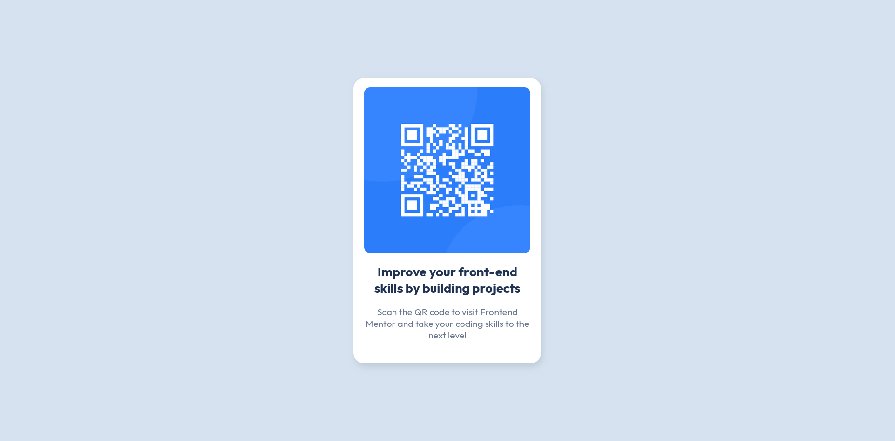

# Frontend Mentor - QR code component solution

This is a solution to the [QR code component challenge on Frontend Mentor](https://www.frontendmentor.io/challenges/qr-code-component-iux_sIO_H). Frontend Mentor challenges help you improve your coding skills by building realistic projects. 

## Table of contents

- [Overview](#overview)
  - [Screenshot](#screenshot)
  - [Links](#links)
- [My process](#my-process)
  - [Built with](#built-with)
  - [What I learned](#what-i-learned)
  - [Continued development](#continued-development)
  - [Useful resources](#useful-resources)
  - [AI Collaboration](#ai-collaboration)

## Overview

### Screenshot




### Links

- Solution URL: [https://davidedb05.github.io/](https://davidedb05.github.io/)

## My process

### Built with

- Semantic HTML5 markup
- CSS custom properties
- Flexbox


### What I learned

I learned how to design a card with the required option using Flexbox

```css
main{font-family:'Outfit', sans-serif;
      display: flex;
      min-height: 100vh;
      justify-content: center;
      align-items: center; 
    }
```
```css
.card{
      display:flex;
      flex-direction: column;
      align-items: center; 
      height: 465px;
      width:305px;
      border-radius: 18px;
      background-color: white;
      box-shadow: 2px 5px 10px #04040419;
    }
```


### Continued development

I will continue to improve how to position the elements and manage marging/padding. In this project I continued to try and try, but I want to learn a faster way to achieve the goal.

### Useful resources

- [CSS Documentation](https://developer.mozilla.org/en-US/docs/Web/CSS) - This helped me for see all the possible CSS attributes.

### AI Collaboration

I minimized the AI use in this project and I only asked (using Gemini in the browser) how to implement Flexbox, so an example of snippet (not for my specific projetc) and the difference from CSS Grid, thus i used it only to learn new things.


